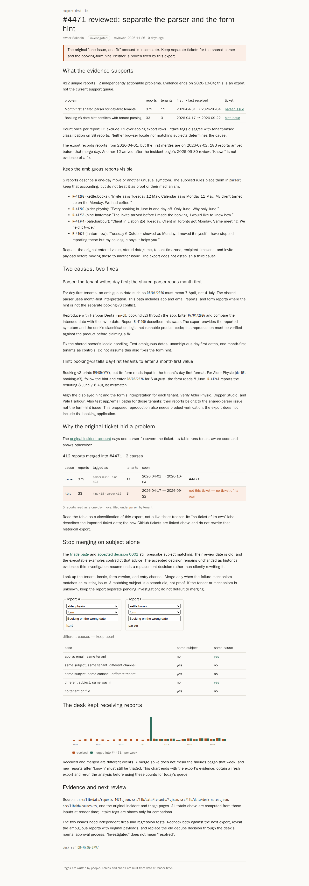

# MEGA S01E03 — what it shows

Review of support ticket **#4471**, using the course's KB export through **4 October 2026**.
The investigation is owned by **Sakadin** and reviewed **26 November 2026**.
Its frontmatter carries the course-issued challenge signature, as required for course verification.

## Deliverables

| Independent problem | Unique reports | GitHub issue |
| --- | ---: | --- |
| Shared month-first parser for day-first tenants | 379 | [#1](https://github.com/Sakadin/megadevpepe/issues/1) |
| Booking-v3 hint conflicts with tenant parsing | 33 | [#2](https://github.com/Sakadin/megadevpepe/issues/2) |
| **Total** | **412** | |

Both tickets are filed and open. Copies of their submitted bodies are in [`issues/`](issues/),
and the page reads its links from [`issue-links.json`](support-kb/src/lib/data/issue-links.json).

- **KB page source:** [`+page.svx`](support-kb/src/routes/kb/incidents/4471-review/+page.svx).
- **Page as the desk sees it:** [full-page screenshot](evidence/4471-review-desktop.png),
  [mobile screenshot](evidence/4471-review-mobile.png), and [PDF](evidence/4471-review.pdf).
- **Actual rendered HTML:** [`index.html`](rendered/kb/incidents/4471-review/index.html).
  The complete static site, including styles and working interactive examples, is in [`rendered/`](rendered/).
- **Audit:** [computed counts and complete report-ID partition](evidence/analysis.json),
  [browser checks](evidence/browser-checks.json).



## View the rendered site

From the repository root:

```sh
python3 -m http.server 8000 --directory rendered
```

Open `http://localhost:8000/kb/incidents/4471-review/`.
GitHub displays HTML as source; use the screenshot/PDF for a direct preview or serve the site above.
No public web host or GitHub Pages setup is required for these repo deliverables.

## Reproduce the analysis and page

Requires Node.js 22.17 or newer. From `support-kb/`:

```sh
npm ci
npm test
npm run analyze
npm run build
npx playwright install chromium
npm run capture
```

The analysis executes the supplied TypeScript functions and `Intl.DateTimeFormat` against the tenant directory.
It does not classify by subjects, browser locales, or intake labels. The export has **427 rows**, including
**15 overlapping rows**, and **38** intake labels disagree with the tenant-aware cause classification.

The five unusual reports listed in `desk-notes.json` remain in the parser accounting, as the supplied
rules specify. The page quotes their bodies and asks for missing original payloads; it does not invent
a proven timezone defect or another root cause from those bodies alone.

The export is historical, not a live queue. Recompute against a fresh export before making claims about
today's totals. The reported product behavior and suggested reproductions have not been tested against
the booking application because the export does not include it.

## Preserve the evidence

The original KB files under `support-kb/src/` are retained unchanged. The review page, summary component,
analysis module, and issue-link mapping are additions. Accepted decision 0001 is not rewritten: the
review explains its conflict with the executable examples and recommends a replacement decision.
The export's original README remains at [`support-kb/README.md`](support-kb/README.md).

The rendered site is a checked-in snapshot, not a claim that the upstream KB or live support queue was changed.
